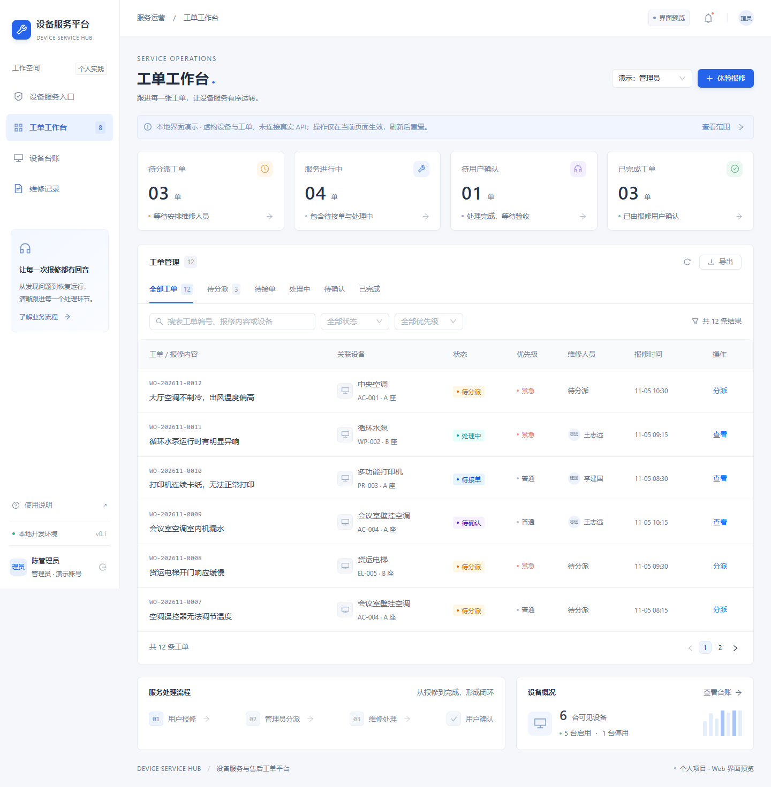

# 设备服务与售后工单平台

面向设备报修、任务分派与维修记录管理的个人全栈实践项目。

核心流程：**设备查询 → 提交报修 → 管理员分派 → 维修人员接单处理 → 报修用户确认 → 查看维修记录**。

目前包含 React Web 完整流程演示，以及连接 NestJS、PostgreSQL 的登录、设备授权查询、文字报修与本人记录链路。移动客户端尚未实现。

## 界面预览



[查看窄屏预览](docs/screenshots/workbench-mobile.png)

[查看真实设备查询界面](docs/screenshots/service-devices.png) · [查看登录界面](docs/screenshots/service-login.png)

[查看本人报修列表](docs/screenshots/service-my-tickets.png) · [查看报修详情](docs/screenshots/service-ticket-detail.png)

[窄屏设备卡片](docs/screenshots/service-devices-mobile.png) · [窄屏报修卡片](docs/screenshots/service-my-tickets-mobile.png)

## 已实现

- 工单工作台：状态统计、关键词与状态筛选、分页、详情时间线及 CSV 导出。
- 报修流程：新建报修、分派与改派、接单、提交处理结果、用户确认、退回与取消。
- 设备台账与维修记录查询。
- 三种演示角色的数据范围：管理员查看全部样例；报修用户查看本人记录与授权设备；维修人员查看当前分派任务。
- 页面路由、响应式布局、CSS Modules，以及公共类型、常量和工具方法。
- NestJS 真实登录、数据库会话、退出登录，以及按用户授权查询设备列表和详情。
- 真实文字报修、本人分页列表与详情；校验设备授权和启用状态，数据库唯一约束与内容摘要处理并发重复请求。

**能力边界：**设备和账号为虚构样例，无真实硬件通信。`/tickets`、`/devices`、`/records` 的完整流程为内存演示，刷新重置。`/login`、`/service/*` 使用真实 API、数据库会话、设备授权和文字报修，身份与演示角色独立；图片上传、真实分派及后续状态操作尚未实现。

## 技术栈

前端使用 React、TypeScript、Vite、React Router、Ant Design、Tailwind CSS、CSS Modules；后端使用 NestJS 11、Prisma 7 和 PostgreSQL 17。使用 npm workspaces 管理应用。

工作区包含 `apps/web`、`apps/api` 和仅提供传输类型的 `packages/contracts`；React Native 客户端按后续功能进度增加。

后续依次推进 React 基础收尾、Next.js 用户门户、React Native 客户端与 Web 微前端集成，详见 [分阶段路线](docs/ROADMAP.md)。Next.js、RN 和微前端目前均未实现；现有 React 后台与 Node.js 业务后端继续保留。

## 快速开始

推荐 Node.js 24、npm 11。在仓库根目录执行：

```sh
npm ci
npm run dev
```

打开 [本地预览](http://127.0.0.1:5173/)，默认进入 `/tickets`；另有 `/devices` 和 `/records`。

```sh
npm run build:web      # 仅 Web 类型检查与生产构建
npm run test:business  # 关键业务规则测试
npm run format        # 格式化源码
```

Web 构建产物输出到 `apps/web/dist`。部署前需为前端路由配置 HTML 回退。

真实设备服务需要先初始化本地数据库，再启动 API，详见 [API 启动与验证](docs/API_SETUP.md)。环境准备后，`npm run build` 同时检查 Web 和 API；API 编译产物输出到 `apps/api/dist`。

报修入口、数据范围和防重复提交说明见 [文字报修与本人记录](docs/TEXT_REPAIR.md)。

## 结构与验证

[结构与维护约定](docs/ARCHITECTURE.md)说明页面、业务模块、公共代码及演示数据的职责边界。

[后端结构与维护约定](docs/BACKEND_ARCHITECTURE.md)说明业务模块、控制层、服务层、鉴权、参数校验和数据访问的职责。

AI 辅助开发前请阅读根目录 [AGENTS.md](AGENTS.md)，遵循目录、复用、状态、样式和验证约定。

已通过类型检查、生产构建和 5 项关键规则测试；浏览器回归覆盖完整工单流程、角色数据范围、路由刷新与前进后退、跨页数据保留、弹窗清理及 390px 窄屏布局。

演示浏览器核对命令为 `npm run verify:ui`，需先启动开发服务。真实链路使用 `npm run verify:api` 和 `npm run verify:connected-ui`，需要数据库及 API。浏览器脚本默认使用 Windows 已安装的 Edge，可通过 `DSH_BROWSER_PATH` 指定其他现有浏览器。

真实链路已验证未登录、跨用户访问、伪造角色字段、退出、会话过期与账号停用，以及浏览器登录、详情、刷新和四账号数据范围；不包含 Android、iOS 或实体业务设备验证。

API 与 PostgreSQL 实际重启后，原会话和授权设备仍可读取，持久化复核通过。

主 JS 包仍有构建体积提示，按需加载与资源优化留待后续处理。
