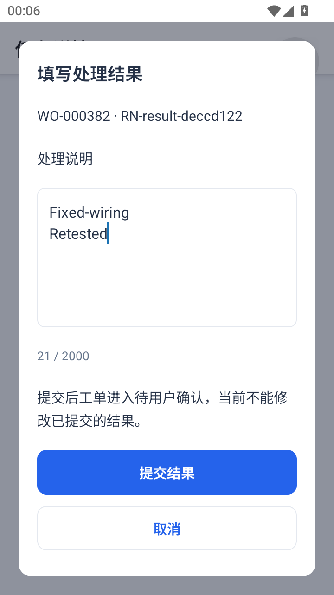
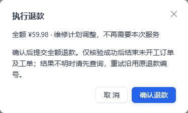

# 设备服务与售后工单平台｜快速导览

结合十余年前端开发、SaaS 后台与多端交付经验，围绕设备售后构建 React 管理后台、Next.js 用户门户和 React Native 客户端，共用 NestJS、Prisma / PostgreSQL 业务后端；qiankun 集成 React 工单后台和 Vue 设备台账。重点体现业务建模、模块边界、服务端权限与并发一致性。

## 先看一条业务链路

**用户报修 → 管理员分派 → 维修人员接单 → 提交报价 → 用户确认 → 服务订单 → 支付 → 维修处理 → 用户确认完成。**

无需报价的工单保留原直接处理分支；付款、退款与维修状态分别管理，开工不等同于付款。

各端读取同一套业务数据，服务端统一检查角色、设备授权、工单归属和状态迁移。

### Next.js：查询设备与提交报修

[手机报修表单](screenshots/portal-repair-mobile.png) · [本人报修记录](screenshots/portal-my-tickets.png)

### React：管理员分派工单

[分派详情](screenshots/service-admin-ticket-detail.png)

### RN：接单处理，用户确认

| 维修任务 | 提交处理结果 | 用户确认 |
| --- | --- | --- |
|  |  |  |

[查看完成记录](screenshots/portal-completed-ticket.png)

## 报价、订单与支付

维修员发布多条目报价，服务端按整数分计算金额；用户确认具体版次后，在同一事务中生成唯一服务订单及金额快照。拒绝后发布新版，不覆盖原报价。订单开工与取消竞争同一工单版本，避免状态相互覆盖。

[报价与服务订单快照](screenshots/portal-order-desktop.png)

| 支付记录 | 全额退款申请 | 管理员退款处理 |
| --- | --- | --- |
|  |  |  |

NestJS 创建支付并签名跳转，支付结果通过通知验签或主动查单核对；金额与订单快照匹配，重复通知幂等处理。未付款先关单，已付款走退款；结果未知保留待核实状态，使用原支付或退款编号恢复。查询通过 Next.js 数据刷新更新页面，不整页重载。

以上支付界面为本地自动化测试截图，使用业务样例数据与渠道响应夹具，保留测试环境标记。实际支付宝沙箱付款、通知、退款查询和未付款关单另有独立验收记录，见 [支付规则与证据](QUOTES.md)；当前未接入真实资金交易，RN 未接入支付宝 SDK。

## 按岗位深入阅读

| 方向 | 阅读重点 | 入口 |
| --- | --- | --- |
| React / Next.js | 业务模块与 Hook、URL 筛选分页、服务端查询与客户端表单、会话转发与个人数据缓存 | [前端结构](ARCHITECTURE.md)、[门户设计](PORTAL.md)、[React 提交 Hook](../apps/web/src/shared/hooks/useApiMutation.ts)、[门户服务端请求](../apps/portal/src/shared/server/request.ts)、[认证提交 Hook](../apps/portal/src/features/auth/useAuthenticatedMutation.ts) |
| Node.js / 支付业务 | Controller、DTO、用例服务与事务；金额快照、通知验签、查单、关单和退款恢复 | [后端结构](BACKEND_ARCHITECTURE.md)、[报价与订单](QUOTES.md)、[支付用例](../apps/api/src/modules/payments/alipay/alipay-sandbox.service.ts)、[退款用例](../apps/api/src/modules/payments/alipay/alipay-sandbox-refunds.service.ts) |
| RN 跨端 | 原生页面与导航、SecureStore 会话、共用 API、扫码与照片、失败反馈 | [移动端设计](MOBILE.md)、[现场照片](TICKET_PHOTOS.md)、[移动端业务模块](../apps/mobile/src/features) |
| 微前端与业务一致性 | React / Vue 挂载卸载、路由和样式隔离、导航消息；服务端越权拦截、事务、防重与版本冲突 | [微前端设计](MICRO_FRONTENDS.md)、[分派规则](ADMIN_ASSIGNMENT.md)、[分派服务](../apps/api/src/modules/tickets/admin-tickets.service.ts) |

时间有限时，优先看业务链路，再选择一个方向阅读。

## 本地体验入口

先按 [环境准备与启动](API_SETUP.md)初始化数据库并启动 API；Windows 使用项目的 `scripts/npm-local.ps1` 执行对应 npm 脚本。本地账号由初始化生成，使用本机私有账号说明中的凭据。

| 应用 | 启动脚本 | 真实业务入口 |
| --- | --- | --- |
| React 后台 | `dev` | [登录](http://127.0.0.1:5173/login)，管理员进入 `/service/admin/tickets`，维修人员进入 `/service/tasks` |
| Next.js 门户 | `dev:portal` | [用户登录](http://127.0.0.1:3000/login)，随后查询设备、报修和本人记录 |
| RN Android | 见移动端文档 | 原生客户端连接同一 API；[安装与内测说明](REMOTE_MOBILE_TEST.md) |
| 微前端 | `build:micro:unified` 后运行 `preview:micro:unified` | [统一入口](http://127.0.0.1:4174)，Vue 台账可导航至 React 设备详情 |

以上地址为本机入口。React 根路径默认展示内存演示；完整真实链路从 `/login` 与 `/service/*` 进入。门户使用独立端口，其设备和工单页面连接真实 API。

## 项目范围

这是个人项目，使用 AI 协作开发，结合需求拆解、代码审核和人工业务操作推进。设备及账号为样例，业务接口、数据库持久化、会话和权限检查为实际实现。

Android 独立 APK 已在 MuMu Android 15 运行文字工单闭环；扫码与照片另有 Expo Go 模拟器记录。实体手机、iOS 原生和商店发布不在当前交付范围。项目以源码与本地演示展示，详细分端记录见 [运行环境与限制](../README.md#验证环境与交付限制)。
