# 设备服务与售后工单平台｜快速导览

结合十余年前端开发、SaaS 后台与多端交付经验，围绕设备售后构建 React 管理后台、Next.js 用户门户和 React Native / Expo 客户端，共用 NestJS、Prisma / PostgreSQL 业务服务与 TypeScript 契约；通过 qiankun 集成 React 工单后台与 Vue 设备台账。重点展示 React / Next.js 业务开发、Android 原生 SDK 集成、支付退款与订单一致性，以及跨框架微前端集成。

## 快速阅读

- **React / Next.js**：业务组件与 Hook、URL 筛选分页、服务端查询与客户端表单、会话转发和用户缓存隔离。
- **React Native / Expo**：扫码、现场照片、会话恢复、支付宝官方 Android SDK 原生模块及支付返回同步。
- **Node.js / NestJS**：报价版本、订单金额快照、支付签名、通知验签、查单、退款与并发状态控制。
- **qiankun 微前端**：React / Vue 子应用独立构建、生命周期、路由协同、Shadow DOM 样式隔离和类型化导航通信。

## 界面概览

平台包含工单工作台、设备台账、用户门户与 Android 客户端，支持桌面表格、窄屏卡片与原生移动端操作。

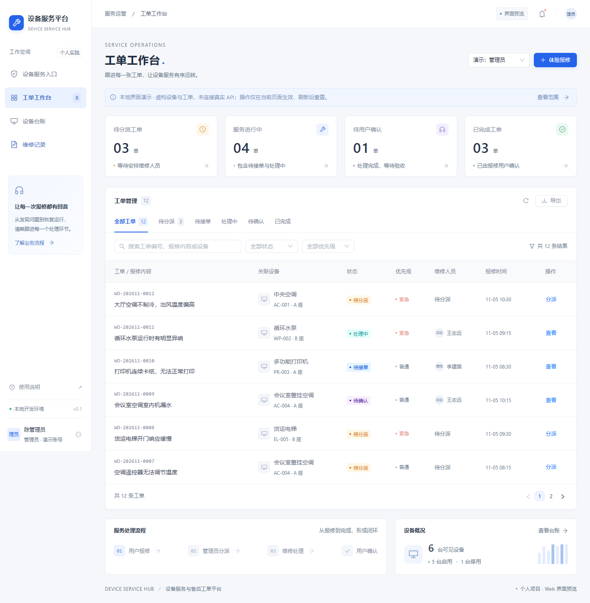

[工作台窄屏布局](screenshots/workbench-mobile.png)。此工作台为内存界面演示，刷新后重置；下方门户、管理员与 RN 业务页面连接本地 API，身份与数据范围由后端校验。

## 先看一条业务链路

**用户报修 → 管理员分派 → 维修人员接单 → 提交报价 → 用户确认报价 → 生成服务订单 → 支付与维修处理 → 用户确认完成。**

无需报价的工单保留原直接处理分支。支付与维修履约分别记录，当前并非所有开工操作都以付款为前提，维修完成也不等于已付款；支付待核实或存在退款申请时，开工与取消由后端规则限制。

另一条分支是：**已支付且未开工 → 用户申请全额退款 → 暂停开工 → Web 管理员执行 → 服务端核验渠道结果 → 同步订单与工单。** 申请退款不等于退款成功，原支付成功事实单独保留。

各端读取同一套业务数据，服务端统一检查角色、设备授权、工单归属和状态迁移。

### Next.js：查询设备与提交报修

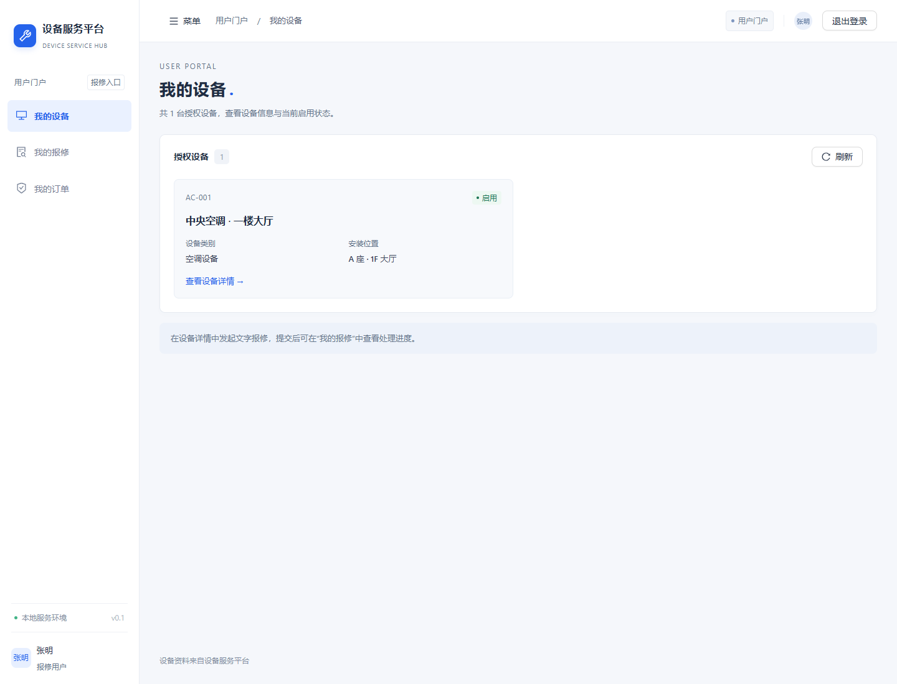

[手机设备页面](screenshots/portal-devices-mobile.png) · [手机报修表单](screenshots/portal-repair-mobile.png) · [本人报修记录](screenshots/portal-my-tickets.png)

### React：管理员分派工单

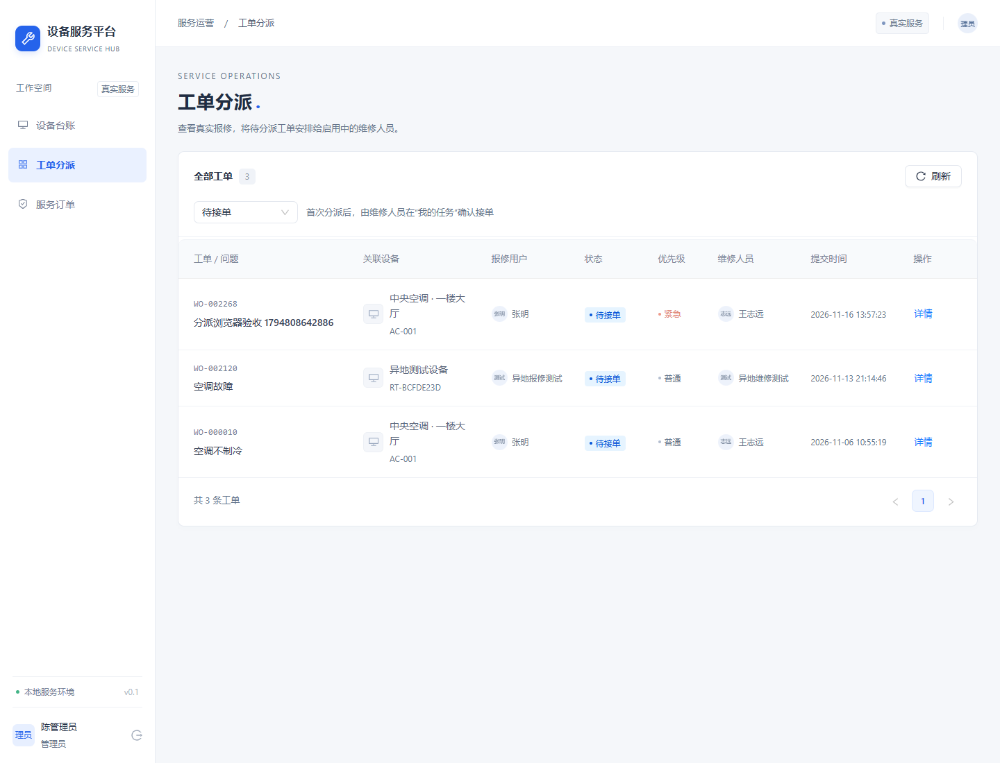

[分派详情](screenshots/service-admin-ticket-detail.png) · [窄屏分派列表](screenshots/service-admin-tickets-mobile.png)

### RN：接单处理，用户确认

| 维修任务 | 本人订单 | 用户确认 |
| --- | --- | --- |
| 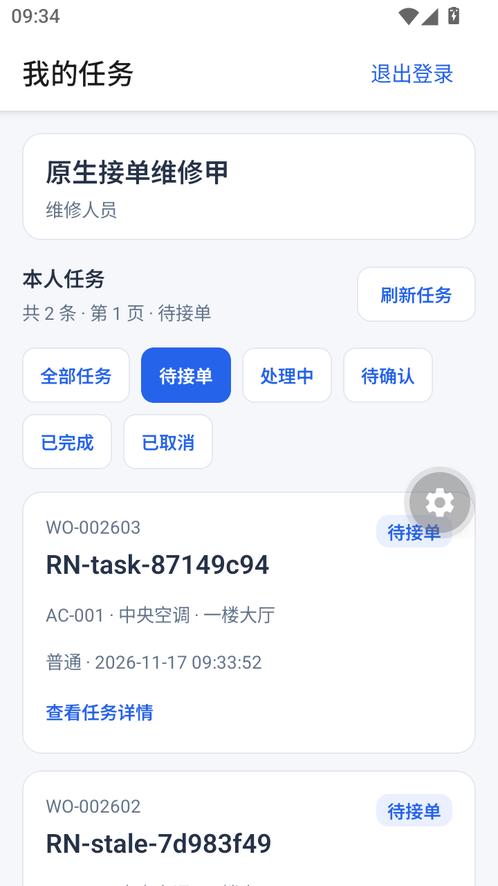 | 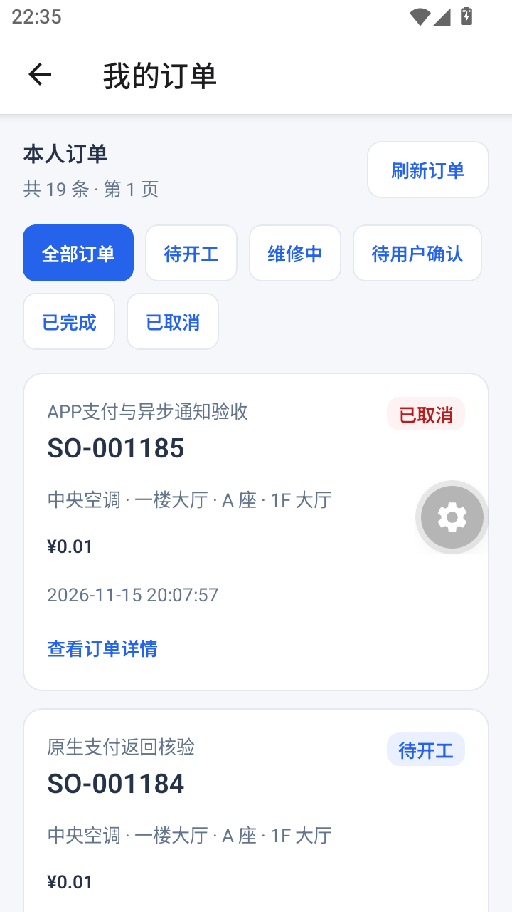 | 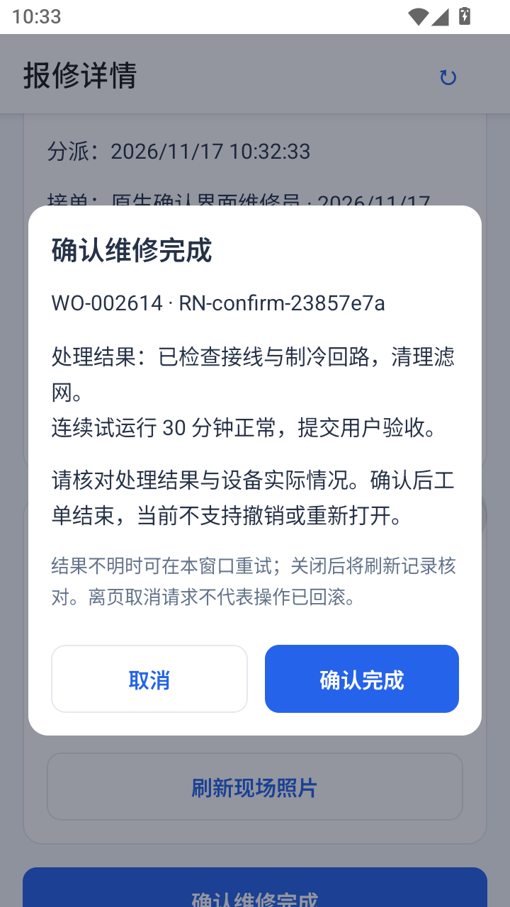 |

[查看 Android 完成记录](screenshots/mobile-android-confirmed.png) · [查看门户完成记录](screenshots/portal-completed-ticket.png)

## 报价、订单与支付

维修员发布多条目报价，服务端按整数分计算金额；用户确认具体版次后，在同一事务中生成唯一服务订单及金额快照。拒绝后发布新版，不覆盖原报价。订单开工与取消竞争同一工单版本，避免状态相互覆盖。

[报价与服务订单快照](screenshots/portal-order-desktop.png) · [管理员订单列表](screenshots/orders-list-admin-desktop.png) · [管理员订单详情](screenshots/order-independent-admin-desktop.png) · [门户手机订单详情](screenshots/portal-order-independent-mobile.png)

### 支付记录与退款操作

用户查看支付状态并提交全额退款申请，管理员核对原支付记录后执行退款，渠道结果由服务端查询并同步。

| 支付记录 | 全额退款申请 | 管理员退款处理 |
| --- | --- | --- |
| 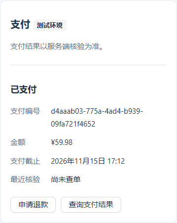 | 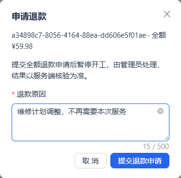 |  |

### 支付：网站收银台与 Android 原生 SDK

- 门户使用支付宝电脑网站支付，RN 通过 Expo 原生模块封装支付宝官方 Android SDK。签名参数由 NestJS 生成，私钥仅保存在服务端。
- 支付记录独立保存金额快照、渠道状态及 `checkoutKind`（`page` / `app`）；同一支付单不能切换网站与 APP 支付方式。
- SDK 返回值仅用于调用反馈，不直接认定付款成功。应用返回前台后，由服务端主动验签查单；公网异步通知同样先验签、核对金额和交易身份，再幂等更新记录。
- SDK 持有期间不刷新整份订单或卸载支付组件，避免 SDK 返回与前台事件竞争；核验完成后更新支付区及取消保护。失败或未知状态保留待核实，提供手动查询入口。
- 未付款支持先查单再关单；截止后查单可触发同一关单核对流程。查单、关单结果不明时不释放取消保护，已付款不能直接取消。

原生调用链：**RN 业务组件 → Expo 原生模块 → 官方 Android SDK → 返回应用 → NestJS 验签查单 → 更新支付记录与页面。**

| Android SDK 收银台 | 付款返回自动同步 | 退款成功回看 |
| --- | --- | --- |
| 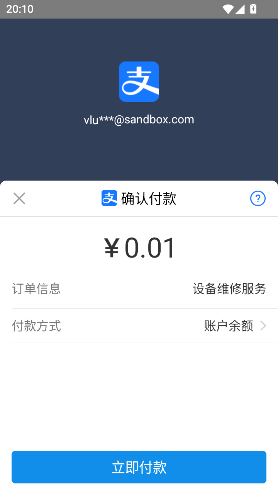 | 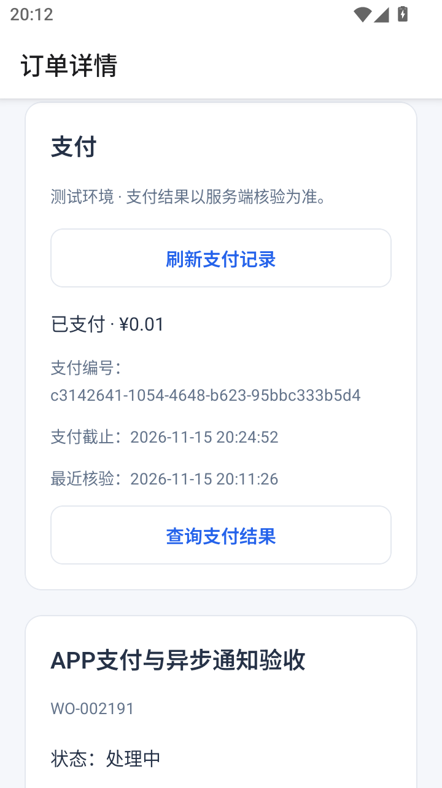 | 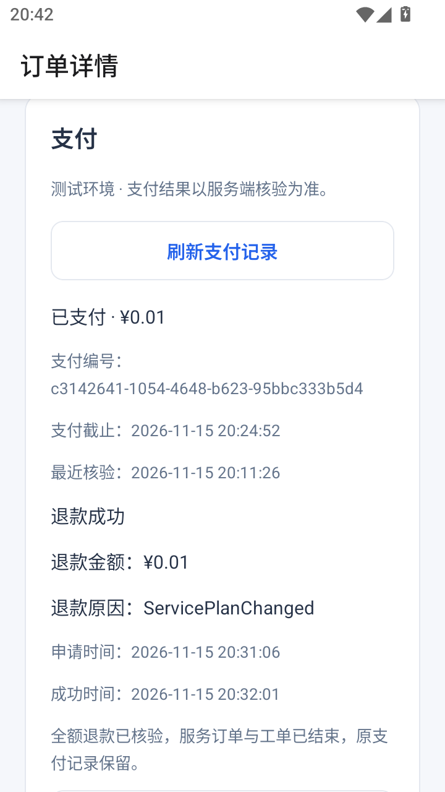 |

### 退款：用户申请与管理员执行分离

用户可在 RN 或门户申请尚未开工订单的全额退款，金额由服务端读取原支付记录，前端只提交原因及请求编号。同一意图重试沿用原编号，修改原因才产生新意图；响应丢失时不直接创建第二笔申请。

申请后暂停开工，管理员在 Web 后台执行退款，服务端查询并核验渠道结果。RN 在打开页面、恢复前台及前台每 5 秒同步待处理记录，离页或切换账号时清理请求与定时器。退款成功后刷新订单和工单，原支付记录仍为成功；原生客户端不提供管理员退款执行入口。

[RN 退款申请](screenshots/mobile-alipay-refund-apply.png) · [申请待处理](screenshots/mobile-alipay-refund-requested.png) · [Web 管理员执行](screenshots/admin-rn-alipay-refund-confirm.png)

### 状态一致性与异常恢复

支付、退款、开工与取消由后端统一检查身份、归属、状态、请求幂等及并发条件。金额使用服务端快照；跨渠道调用与数据库提交不构成一个可回滚事务，渠道结果不明或本地写入失败时，通过原编号查单恢复，不能用前端成功提示替代渠道核验。

- 支付返回与异步通知使用服务端核验结果更新同一支付记录，重复通知保持幂等。
- 退款申请、渠道执行与结果查询分开管理，客户端通过前台同步与重新进入页面恢复订单状态。
- 写请求响应丢失时沿用原请求编号重试，结合版本与状态检查防止重复执行。

支付与退款使用支付宝测试环境。门户与后台支付截图使用业务样例及渠道响应夹具；Android SDK 截图对应测试渠道操作。详细实现与运行记录见 [移动端支付与退款](MOBILE.md#新订单支付返回与-app-公网通知验收2026-11-15) 和 [支付规则与证据](QUOTES.md)。

## qiankun 微前端集成

`apps/shell` 统一承载 React 工单后台和 Vue 设备台账，各应用保留独立构建与入口。Next.js 门户和 RN 客户端独立运行，通过业务 API 与共享契约协作，不放入 qiankun 容器。

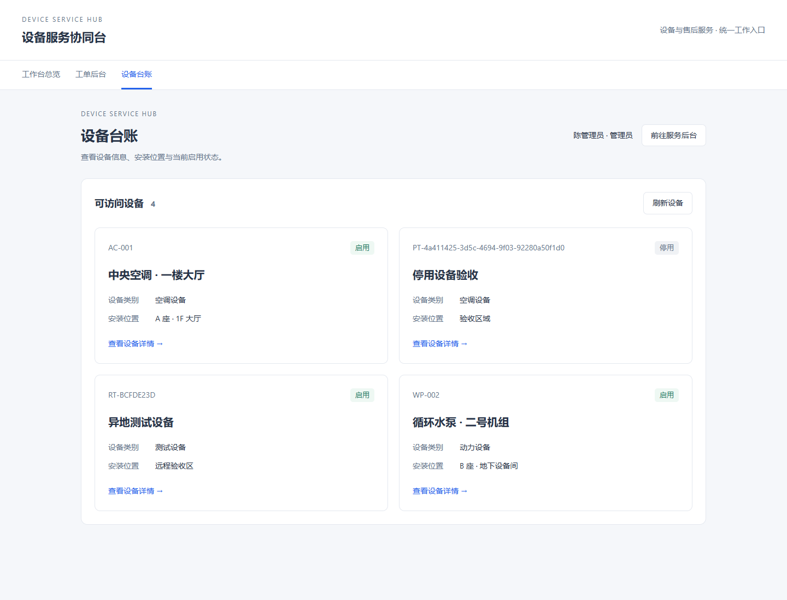

[跨应用设备详情导航](screenshots/micro-device-navigation.png) · [React 工单后台](screenshots/micro-tickets-desktop.png) · [Vue 台账窄屏](screenshots/micro-vue-devices-mobile.png) · [React 工单窄屏](screenshots/micro-tickets-mobile.png)

- **生命周期**：切换应用先卸载旧实例；Vue 释放 App、Router 与 history，React 卸载 Root，并取消读取、清理监听与图片资源。
- **路由协同**：主应用管理 `/tickets/*` 与 `/devices/*`，子应用接管内部路由；保留深层地址刷新、筛选、前进后退，避免未知路由重定向抢回主应用导航。
- **样式隔离**：Shadow DOM 隔离子应用静态样式，Ant Design 浮层和消息容器保持在 React 子应用内部。
- **跨应用通信**：共享 `ServiceNavigationRequest` 类型，主应用核对动作、版本和设备 ID，映射到固定内部路径，实现 Vue 台账到 React 设备详情的跳转。消息不传令牌或角色，业务权限仍由服务端校验。
- **构建适配**：保留独立 Vite ESM 入口，另外构建 qiankun 兼容的 UMD 生命周期产物；本地统一入口处理页面回退、同源资源与 API 转发。

微前端通过本地统一入口运行，共用业务后端与会话鉴权。细节见 [微前端设计](MICRO_FRONTENDS.md)。

## 组件与契约复用

跨端复用业务 API、TypeScript 传输契约及适用的纯规则；React、Next.js 与 RN 分别组织界面、导航和会话适配，不直接共享 Web DOM 或组件样式。

RN 支付展示与取消保护共用一份支付读取快照，避免取消组件重复请求；模拟退款与支付宝退款共用原因表单，渠道资格和接口各自保留。本人报修、维修任务与本人订单复用受控分页组件，列表请求、筛选与翻页状态仍由业务页面管理。

## 按岗位深入阅读

| 方向 | 阅读重点 | 入口 |
| --- | --- | --- |
| React / Next.js | 业务模块与 Hook、URL 筛选分页、服务端查询与客户端表单、会话转发与个人数据缓存 | [前端结构](ARCHITECTURE.md)、[门户设计](PORTAL.md)、[React 提交 Hook](../apps/web/src/shared/hooks/useApiMutation.ts)、[门户服务端请求](../apps/portal/src/shared/server/request.ts)、[认证提交 Hook](../apps/portal/src/features/auth/useAuthenticatedMutation.ts) |
| Node.js / 支付业务 | Controller、DTO、用例服务与事务；金额快照、通知验签、查单、关单和退款恢复 | [后端结构](BACKEND_ARCHITECTURE.md)、[报价与订单](QUOTES.md)、[支付用例](../apps/api/src/modules/payments/alipay/alipay-sandbox.service.ts)、[退款用例](../apps/api/src/modules/payments/alipay/alipay-sandbox-refunds.service.ts) |
| RN / 原生 SDK | 扫码与照片、会话恢复、JS 与原生调用、支付返回竞争、退款同步 | [移动端设计](MOBILE.md)、[JS 调用适配](../apps/mobile/src/features/payments/alipay/nativeSdk.ts)、[Android SDK 模块](../apps/mobile/modules/alipay-sandbox/android/src/main/java/expo/modules/alipaysandbox/AlipaySandboxModule.kt)、[支付返回核验](../apps/mobile/src/features/payments/alipay/reconcileAlipayReturn.ts)、[退款同步](../apps/mobile/src/features/payments/alipay/AlipayRefundSection.tsx) |
| qiankun 微前端 | 独立构建、React / Vue 生命周期、路由协同、Shadow DOM 样式隔离、类型化导航 | [微前端设计](MICRO_FRONTENDS.md)、[挂载与卸载](../apps/shell/src/micro/useMicroApp.ts)、[导航协议校验](../apps/shell/src/micro/navigation.ts) |
| 业务一致性与复用 | 服务端权限、事务、幂等与版本冲突；共享契约、退款表单及受控分页 | [分派规则](ADMIN_ASSIGNMENT.md)、[订单与支付](QUOTES.md)、[共享契约](../packages/contracts/src/index.ts)、[退款表单](../apps/mobile/src/features/payments/RefundRequestForm.tsx)、[RN 分页](../apps/mobile/src/shared/components/Pagination.tsx) |

时间有限时，优先看业务链路，再选择一个方向阅读。

## 本地体验入口

先按 [环境准备与启动](API_SETUP.md)初始化数据库并启动 API；Windows 使用项目的 `scripts/npm-local.ps1` 执行对应 npm 脚本。本地账号由初始化生成，使用本机私有账号说明中的凭据。

| 应用 | 启动脚本 | 真实业务入口 |
| --- | --- | --- |
| React 后台 | `dev` | [登录](http://127.0.0.1:5173/login)，管理员进入 `/service/admin/tickets`，维修人员进入 `/service/tasks` |
| Next.js 门户 | `dev:portal` | [用户登录](http://127.0.0.1:3000/login)，随后查询设备、报修和本人记录 |
| RN Android | 见移动端文档 | 原生客户端连接同一 API；[安装与内测说明](REMOTE_MOBILE_TEST.md) |
| 微前端 | `build:micro:unified` 后运行 `preview:micro:unified` | [统一入口](http://127.0.0.1:4174)，Vue 台账可导航至 React 设备详情 |

以上地址为本机入口。React 根路径默认展示内存演示；完整真实链路从 `/login` 与 `/service/*` 进入。门户使用独立端口，其设备和工单页面连接真实 API。

## 项目范围

这是个人项目，使用 AI 协作开发，结合需求拆解、代码审核和人工业务操作推进。设备及账号为样例，业务接口、数据库持久化、会话和权限检查为实际实现。

Android 客户端提供独立 APK，包含文字工单、扫码、现场照片与支付宝原生 SDK 集成。工单与支付退款链路在 MuMu Android 15 独立 APK 中运行；基础功能另有真机运行记录，支付真机、iOS 支付、商店发布及生产部署不在本项目展示范围。项目以源码与本地演示展示，分端说明见 [移动端设计与验证](MOBILE.md) 和 [异地内测边界](REMOTE_MOBILE_TEST.md)。
